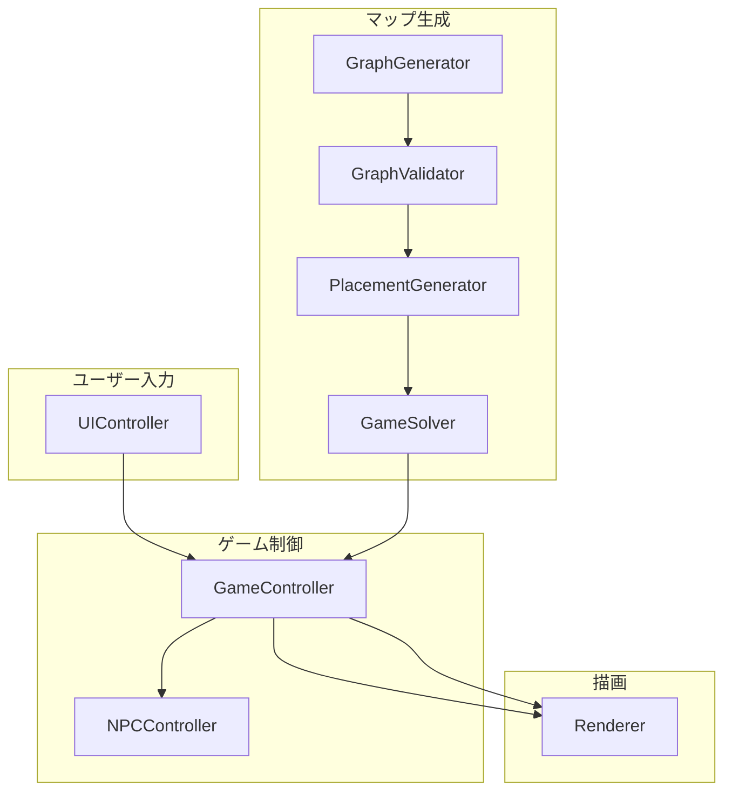
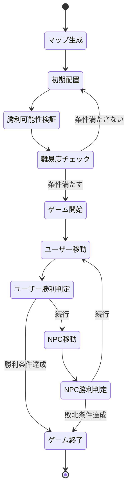
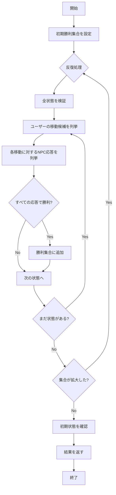

# Spider Chase 実装計画

## プロジェクト概要

ブラウザ上で動作する1対1のターン制鬼ごっこゲーム。蜘蛛の巣型マップを自動生成し、ゲーム理論による勝利保証を計算する。

### 技術スタック
- HTML5 + CSS3 + JavaScript（標準機能のみ）
- SVG（マップ描画）
- 外部ライブラリ不使用
- 1ファイル構成（`index.html`）

### ファイル構成
```
webgame/SpiderChase/
└── index.html  # すべてのコードを含む単一ファイル
```

---

## 実装段階の概要

開発は6段階に分けて実施し、各段階で動作確認を行う。

---

## 第1段階：蜘蛛の巣型グラフ生成、検証、SVG描画

### 目的
マップの基本構造を生成し、正しく描画できることを確認する。

### 実装内容

#### 1. GraphGenerator クラス
**責務：** 蜘蛛の巣型グラフを生成する

**データ構造：**
```javascript
// ノード構造
{
  id: string,           // 一意のID (例: "r1_s0")
  r: number,            // リング番号 (0-based)
  s: number,            // 放射方向番号 (0-based)
  x: number,            // SVG描画用X座標
  y: number,            // SVG描画用Y座標
  neighbors: string[]   // 隣接ノードのIDリスト
}

// グラフ構造
{
  nodes: Map<string, Node>,  // ノードIDからノードへのマップ
  edges: Set<string>         // エッジのセット（ソート済みID組 "id1|id2"）
}
```

**生成パラメータ：**
- `R`: リング数（内側から外側へ）
- `S`: 放射方向数
- `diagonalProb`: 斜め接続の確率（0.0～1.0）
- `angleVariation`: 角度のランダム変動幅（0.0～1.0）
- `seed`: 乱数シード（再現性のため）

**生成アルゴリズム：**
1. 極座標ベースで各ノードの基本位置を計算
   - リングr、方向sのノードの基本角度：`θ = (2π * s) / S + random * angleVariation`
   - 半径：リング番号に比例
   - デカルト座標に変換：`(x, y) = (r * cos(θ), r * sin(θ))`

2. 基本接続を追加
   - **同一リング内**: 隣接する放射方向のノードを接続
   - **リング間**: 各ノードを外側リングの対応位置（または隣接位置）と接続

3. ランダム斜め接続を追加
   - 確率`diagonalProb`で斜め方向の隣接ノードと接続
   - すでに接続済みの組は重複追加しない

4. 双方向性を保証
   - `neighbors`配列は相互に追加される

**実装メソッド：**
```javascript
class GraphGenerator {
  constructor(seed) { /* 乱数生成器初期化 */ }
  
  generate(R, S, diagonalProb, angleVariation) {
    // グラフ生成ロジック
    // 1. ノード生成
    // 2. 基本接続
    // 3. ランダム接続
    return { nodes, edges };
  }
  
  _createNode(r, s, R, S, angleVariation) {
    // 個別ノード生成
  }
  
  _addEdge(nodes, edges, id1, id2) {
    // エッジ追加（双方向）
  }
}
```

#### 2. GraphValidator クラス
**責務：** 生成されたグラフが要件を満たすか検証する

**検証項目：**
1. **ノード数チェック**: 最小ノード数以上か
2. **次数チェック**: 全ノードの次数が2以上か
3. **連結性チェック**: 全ノードがBFS/DFSで到達可能か
4. **自己ループチェック**: 自分自身への接続がないか
5. **重複エッジチェック**: 同じエッジが複数回登録されていないか
6. **双方向性チェック**: すべてのエッジが双方向か

**実装メソッド：**
```javascript
class GraphValidator {
  validate(graph, minNodes) {
    const errors = [];
    
    // 各検証を実行
    if (!this._checkNodeCount(graph, minNodes)) {
      errors.push("ノード数が不足");
    }
    if (!this._checkDegrees(graph)) {
      errors.push("次数1以下のノードが存在");
    }
    if (!this._checkConnectivity(graph)) {
      errors.push("非連結なノードが存在");
    }
    // ... 他の検証
    
    return {
      valid: errors.length === 0,
      errors: errors
    };
  }
  
  _checkConnectivity(graph) {
    // BFSで全ノード到達可能性をチェック
  }
  
  // ... 他の検証メソッド
}
```

#### 3. Renderer クラス（第1段階の範囲）
**責務：** グラフをSVGで描画する

**描画要素：**
- 通路（エッジ）：線（`<line>`）
- ノード：円（`<circle>`）
- 座標系：中央を原点とし、viewBoxで調整

**実装メソッド：**
```javascript
class Renderer {
  constructor(svgElement) {
    this.svg = svgElement;
    this.viewSize = 800; // viewBoxサイズ
  }
  
  renderGraph(graph) {
    // SVGをクリア
    this.svg.innerHTML = '';
    
    // viewBox設定（中央原点）
    const half = this.viewSize / 2;
    this.svg.setAttribute('viewBox', 
      `${-half} ${-half} ${this.viewSize} ${this.viewSize}`);
    
    // エッジを先に描画（ノードの下に）
    this._renderEdges(graph);
    
    // ノードを描画
    this._renderNodes(graph);
  }
  
  _renderEdges(graph) {
    // 各エッジをlineで描画
  }
  
  _renderNodes(graph) {
    // 各ノードをcircleで描画
  }
}
```

#### 4. 基本的なHTML構造
```html
<!DOCTYPE html>
<html lang="ja">
<head>
  <meta charset="UTF-8">
  <title>Spider Chase</title>
  <style>
    body { 
      margin: 0; 
      padding: 20px; 
      font-family: sans-serif; 
    }
    #gameArea {
      border: 1px solid #ccc;
      width: 800px;
      height: 800px;
    }
    #controls {
      margin-bottom: 20px;
    }
  </style>
</head>
<body>
  <div id="controls">
    <label>リング数: <input type="number" id="ringCount" value="4" min="2" max="10"></label>
    <label>放射方向数: <input type="number" id="spokeCount" value="8" min="4" max="16"></label>
    <label>斜め接続確率: <input type="number" id="diagonalProb" value="0.3" min="0" max="1" step="0.1"></label>
    <button id="generateBtn">マップ生成</button>
  </div>
  
  <svg id="gameArea" width="800" height="800"></svg>
  
  <div id="info">
    <h3>生成情報</h3>
    <div id="graphInfo"></div>
  </div>
  
  <script>
    // ========================================
    // セクション1: GraphGenerator
    // ========================================
    class GraphGenerator {
      // ... 実装
    }
    
    // ========================================
    // セクション2: GraphValidator
    // ========================================
    class GraphValidator {
      // ... 実装
    }
    
    // ========================================
    // セクション3: Renderer
    // ========================================
    class Renderer {
      // ... 実装
    }
    
    // ========================================
    // セクション4: 初期化とイベント処理
    // ========================================
    document.getElementById('generateBtn').addEventListener('click', () => {
      // マップ生成処理
    });
  </script>
</body>
</html>
```

#### 第1段階の動作確認項目
- [ ] 蜘蛛の巣型のマップが描画される
- [ ] リング数と放射方向数を変更できる
- [ ] 斜め接続確率を変更できる
- [ ] 生成されたノード数と通路数が表示される
- [ ] 検証エラーが発生した場合、エラー内容が表示される
- [ ] 全ノードが次数2以上である
- [ ] 全ノードが連結している

---

## 第2段階：ユーザーとNPCの配置、基本移動、ターン進行

### 目的
ゲームの基本的なプレイフローを実装する。

### 実装内容

#### 1. PlacementGenerator クラス
**責務：** USER、NPC、GOALを適切な位置に配置する

**配置条件：**
- 3つは必ず異なるノード
- USERとGOALの距離が極端に近くない（閾値：最短距離2以上）
- USERとNPCの距離が極端に近くない（閾値：最短距離2以上）

**実装メソッド：**
```javascript
class PlacementGenerator {
  constructor(seed) { /* 乱数生成器 */ }
  
  generatePlacement(graph, mode) {
    // mode: "CHASE" (ユーザーが逃走者) or "ESCAPE" (ユーザーが追跡者)
    
    const nodeIds = Array.from(graph.nodes.keys());
    let attempts = 0;
    const maxAttempts = 1000;
    
    while (attempts < maxAttempts) {
      // ランダムに3つのノードを選択
      const placement = this._randomPlacement(nodeIds);
      
      // 距離条件をチェック
      if (this._checkDistances(graph, placement)) {
        return placement;
      }
      
      attempts++;
    }
    
    throw new Error("適切な配置が見つかりませんでした");
  }
  
  _randomPlacement(nodeIds) {
    // USER、NPC、GOALをランダムに配置
  }
  
  _checkDistances(graph, placement) {
    // BFSで最短距離を計算し、条件を満たすかチェック
  }
  
  _bfs(graph, startId, endId) {
    // 最短距離を計算（ノード数）
  }
}
```

#### 2. GameController クラス（基本部分）
**責務：** ゲームの状態管理とターン進行を制御する

**ゲーム状態：**
```javascript
{
  graph: Graph,              // マップ
  userPos: string,           // ユーザーの現在位置（ノードID）
  npcPos: string,            // NPCの現在位置
  goalPos: string,           // ゴールの位置
  mode: string,              // "CHASE" or "ESCAPE"
  turn: number,              // 現在のターン数
  state: string,             // "PLAYING", "USER_WIN", "USER_LOSE"
  history: Array             // 移動履歴
}
```

**実装メソッド：**
```javascript
class GameController {
  constructor(graph, placement, mode) {
    this.graph = graph;
    this.userPos = placement.user;
    this.npcPos = placement.npc;
    this.goalPos = placement.goal;
    this.mode = mode;
    this.turn = 0;
    this.state = "PLAYING";
    this.history = [];
  }
  
  getValidMoves() {
    // ユーザーの現在位置から移動可能なノードのリストを返す
    const currentNode = this.graph.nodes.get(this.userPos);
    return currentNode.neighbors;
  }
  
  moveUser(targetId) {
    // ユーザーを移動
    if (!this.canMove(targetId)) {
      return { success: false, reason: "移動不可能なノード" };
    }
    
    this.userPos = targetId;
    this.history.push({ turn: this.turn, type: "USER", from: this.userPos, to: targetId });
    
    // 勝利判定（ユーザー移動後）
    if (this._checkUserVictory()) {
      this.state = this.mode === "CHASE" ? "USER_WIN" : "USER_WIN";
      return { success: true, gameState: this.state };
    }
    
    // NPC移動（後の段階で実装）
    // this.moveNPC();
    
    this.turn++;
    return { success: true, gameState: this.state };
  }
  
  canMove(targetId) {
    // 移動可能かチェック
    return this.getValidMoves().includes(targetId);
  }
  
  _checkUserVictory() {
    // 勝利条件チェック（モードごと）
    if (this.mode === "CHASE") {
      // ユーザーが逃走者：ゴールに到達
      return this.userPos === this.goalPos;
    } else {
      // ユーザーが追跡者：NPCを捕獲
      return this.userPos === this.npcPos;
    }
  }
  
  _checkUserDefeat() {
    // 敗北条件チェック（モードごと）
    if (this.mode === "CHASE") {
      // ユーザーが逃走者：NPCに捕獲される
      return this.userPos === this.npcPos;
    } else {
      // ユーザーが追跡者：NPCがゴールに到達
      return this.npcPos === this.goalPos;
    }
  }
}
```

#### 3. Renderer クラス（拡張）
**追加描画要素：**
- USER：青色の円（大きめ）
- NPC：赤色の円（大きめ）
- GOAL：黄色の円（大きめ）
- 移動可能ノード：緑色で強調、クリック可能

**実装メソッド：**
```javascript
class Renderer {
  // ... 既存メソッド
  
  renderGameState(gameController) {
    // グラフ描画
    this.renderGraph(gameController.graph);
    
    // 特殊ノードを上書き描画
    this._renderGoal(gameController.goalPos);
    this._renderNPC(gameController.npcPos);
    this._renderUser(gameController.userPos);
    
    // 移動可能ノードを強調
    if (gameController.state === "PLAYING") {
      this._highlightValidMoves(gameController.getValidMoves());
    }
  }
  
  _renderUser(nodeId) {
    // USERを青色で描画
  }
  
  _renderNPC(nodeId) {
    // NPCを赤色で描画
  }
  
  _renderGoal(nodeId) {
    // GOALを黄色で描画
  }
  
  _highlightValidMoves(validMoves) {
    // 移動可能ノードを緑色で強調
  }
}
```

#### 4. UIController クラス（基本部分）
**責務：** ユーザー入力とUI更新を管理する

**実装メソッド：**
```javascript
class UIController {
  constructor(gameController, renderer) {
    this.gameController = gameController;
    this.renderer = renderer;
    this._setupEventListeners();
  }
  
  _setupEventListeners() {
    // SVG上のノードクリックイベント
    // 移動可能なノードがクリックされたらmoveUserを呼ぶ
  }
  
  updateDisplay() {
    // ゲーム状態を画面に反映
    this.renderer.renderGameState(this.gameController);
    this._updateInfo();
  }
  
  _updateInfo() {
    // 情報エリアを更新
    // - 現在のターン数
    // - ユーザーとNPCの位置
    // - 各種距離情報
  }
}
```

#### 第2段階の動作確認項目
- [ ] USER、NPC、GOALがマップ上に配置される
- [ ] USERから移動可能なノードが緑色で表示される
- [ ] 移動可能なノードをクリックするとUSERが移動する
- [ ] 移動不可能なノードはクリックしても移動しない
- [ ] ターン数が正しく増加する
- [ ] ユーザーがゴールに到達すると勝利表示（CHASE モード）
- [ ] 配置が極端に近すぎる場合は再生成される

---

## 第3段階：追跡AIと逃走AI、勝敗判定

### 目的
NPCの行動アルゴリズムを実装し、完全なゲームプレイを可能にする。

### 実装内容

#### 1. NPCController クラス
**責務：** NPCの行動を決定する

**AIレベル：**
1. **距離優先（SIMPLE）**: 目標への最短距離のみで判断
2. **回避型（MODERATE）**: 相手との距離も考慮
3. **予測型（ADVANCED）**: 相手の次の行動を予測（第3段階では未実装でも可）

**実装メソッド：**
```javascript
class NPCController {
  constructor(aiLevel) {
    this.aiLevel = aiLevel; // "SIMPLE", "MODERATE", "ADVANCED"
  }
  
  chooseMove(graph, npcPos, userPos, goalPos, mode) {
    // mode: "CHASE" (NPCが追跡者) or "ESCAPE" (NPCが逃走者)
    
    if (mode === "CHASE") {
      return this._chaseMove(graph, npcPos, userPos);
    } else {
      return this._escapeMove(graph, npcPos, userPos, goalPos);
    }
  }
  
  _chaseMove(graph, npcPos, userPos) {
    // 追跡AI：ユーザーとの距離を短縮する
    const neighbors = graph.nodes.get(npcPos).neighbors;
    
    let bestMove = null;
    let bestDistance = Infinity;
    
    for (const neighborId of neighbors) {
      const distance = this._bfsDistance(graph, neighborId, userPos);
      
      // 同じ距離の場合はランダム選択のためのロジックが必要
      if (distance < bestDistance) {
        bestDistance = distance;
        bestMove = neighborId;
      }
    }
    
    return bestMove;
  }
  
  _escapeMove(graph, npcPos, userPos, goalPos) {
    // 逃走AI：ゴールに近づきつつユーザーから遠ざかる
    const neighbors = graph.nodes.get(npcPos).neighbors;
    
    let bestMove = null;
    let bestScore = -Infinity;
    
    for (const neighborId of neighbors) {
      // ゴールまでの距離（小さいほど良い）
      const distToGoal = this._bfsDistance(graph, neighborId, goalPos);
      
      // ユーザーまでの距離（大きいほど良い）
      const distToUser = this._bfsDistance(graph, neighborId, userPos);
      
      // スコア計算（調整可能）
      const score = distToUser * 2 - distToGoal;
      
      if (score > bestScore) {
        bestScore = score;
        bestMove = neighborId;
      }
    }
    
    return bestMove;
  }
  
  _bfsDistance(graph, startId, endId) {
    // BFSで最短距離を計算
  }
}
```

#### 2. GameController クラス（拡張）
**追加機能：** NPC移動と完全な勝敗判定

**実装メソッド：**
```javascript
class GameController {
  // ... 既存メソッド
  
  setNPCController(npcController) {
    this.npcController = npcController;
  }
  
  moveUser(targetId) {
    // ... ユーザー移動と勝利判定（既存）
    
    // ユーザーが勝利していなければNPC移動
    if (this.state === "PLAYING") {
      this.moveNPC();
    }
    
    this.turn++;
    return { success: true, gameState: this.state };
  }
  
  moveNPC() {
    if (this.state !== "PLAYING") return;
    
    // NPCの移動先を決定
    const npcMode = this.mode === "CHASE" ? "CHASE" : "ESCAPE";
    const nextPos = this.npcController.chooseMove(
      this.graph, 
      this.npcPos, 
      this.userPos, 
      this.goalPos, 
      npcMode
    );
    
    if (nextPos) {
      this.npcPos = nextPos;
      this.history.push({ 
        turn: this.turn, 
        type: "NPC", 
        from: this.npcPos, 
        to: nextPos 
      });
      
      // 敗北判定（NPC移動後）
      if (this._checkUserDefeat()) {
        this.state = "USER_LOSE";
      }
    }
  }
}
```

#### 3. UI更新
**追加表示項目：**
- ゲーム終了時のメッセージ（勝利/敗北）
- リスタートボタン
- ゲームモード選択（CHASE/ESCAPE）
- AIレベル選択

#### 第3段階の動作確認項目
- [ ] NPCが正しく移動する（追跡時）
- [ ] NPCが正しく移動する（逃走時）
- [ ] ユーザーがゴールに到達すると勝利する（CHASEモード）
- [ ] NPCがユーザーを捕獲すると敗北する（CHASEモード）
- [ ] ユーザーがNPCを捕獲すると勝利する（ESCAPEモード）
- [ ] NPCがゴールに到達すると敗北する（ESCAPEモード）
- [ ] ゲーム終了後は移動できない
- [ ] リスタートで同じマップで再配置される

---

## 第4段階：GameSolverによる勝利保証と最小勝利手数の計算

### 目的
ゲーム理論に基づく正確な勝利可能性分析を実装する。

### 理論的背景

**状態空間：**
- 状態 `S = (u, p)` : ユーザー位置とNPC位置の組
- 最大状態数：`N × (N-1)` （同一位置は除外）

**ターン構造：**
1. ユーザーが移動
2. ユーザーの勝利条件をチェック
3. NPCが移動（ユーザーが勝利していなければ）
4. ユーザーの敗北条件をチェック

**勝利集合の計算（後退解析）：**
- 初期勝利集合 `W0`：即座に勝利する状態
- 反復拡張：NPCのすべての応答に対して勝利できる状態を追加
- 不動点まで繰り返す

### 実装内容

#### 1. GameSolver クラス
**責務：** 初期配置が勝利可能か判定し、最小勝利手数を計算する

**データ構造：**
```javascript
// 状態を文字列で表現
stateKey = `${userPos}|${npcPos}`

// 勝利集合
winningStates = Set<stateKey>

// 最小手数マップ
minTurns = Map<stateKey, number>
```

**実装メソッド：**
```javascript
class GameSolver {
  solve(graph, userPos, npcPos, goalPos, mode) {
    // mode: "CHASE" or "ESCAPE"
    
    if (mode === "CHASE") {
      return this._solveChaseMode(graph, userPos, npcPos, goalPos);
    } else {
      return this._solveEscapeMode(graph, userPos, npcPos, goalPos);
    }
  }
  
  _solveChaseMode(graph, userPos, npcPos, goalPos) {
    // ユーザーが逃走者モードの解析
    
    const winningStates = new Set();
    const minTurns = new Map();
    
    // 初期勝利集合：ユーザーがゴールにいる状態
    const nodeIds = Array.from(graph.nodes.keys());
    for (const u of nodeIds) {
      if (u === goalPos) {
        for (const p of nodeIds) {
          if (u !== p) { // 捕獲状態は除外
            const key = `${u}|${p}`;
            winningStates.add(key);
            minTurns.set(key, 0);
          }
        }
      }
    }
    
    // 後退解析
    let iteration = 0;
    let changed = true;
    
    while (changed && iteration < 1000) {
      changed = false;
      iteration++;
      
      // すべての状態を検証
      for (const u of nodeIds) {
        for (const p of nodeIds) {
          if (u === p) continue; // 捕獲状態はスキップ
          
          const currentKey = `${u}|${p}`;
          if (winningStates.has(currentKey)) continue; // すでに勝利集合
          
          // ユーザーの移動候補をチェック
          const userNeighbors = graph.nodes.get(u).neighbors;
          
          for (const u_next of userNeighbors) {
            // NPCのすべての応答をチェック
            const npcNeighbors = graph.nodes.get(p).neighbors;
            let allResponsesWin = true;
            let maxResponseTurns = -1;
            
            for (const p_next of npcNeighbors) {
              const nextKey = `${u_next}|${p_next}`;
              
              // ユーザーがゴールに到達（即勝利）
              if (u_next === goalPos) {
                maxResponseTurns = Math.max(maxResponseTurns, 0);
                continue;
              }
              
              // 捕獲される（この応答では負け）
              if (u_next === p_next) {
                allResponsesWin = false;
                break;
              }
              
              // この応答後の状態が勝利集合にあるか
              if (!winningStates.has(nextKey)) {
                allResponsesWin = false;
                break;
              }
              
              maxResponseTurns = Math.max(maxResponseTurns, minTurns.get(nextKey));
            }
            
            // すべての応答に対して勝利できる移動が1つでも存在すれば勝利
            if (allResponsesWin && maxResponseTurns >= 0) {
              winningStates.add(currentKey);
              minTurns.set(currentKey, maxResponseTurns + 1);
              changed = true;
              break; // この状態は解決済み
            }
          }
        }
      }
    }
    
    // 初期状態の判定
    const initialKey = `${userPos}|${npcPos}`;
    const canWin = winningStates.has(initialKey);
    const minWinTurns = canWin ? minTurns.get(initialKey) : Infinity;
    
    return {
      canWin: canWin,
      minTurns: minWinTurns,
      winningStates: winningStates,
      iterations: iteration
    };
  }
  
  _solveEscapeMode(graph, userPos, npcPos, goalPos) {
    // ユーザーが追跡者モードの解析
    // CHASEモードと同様の後退解析
    // 初期勝利集合：ユーザー位置 == NPC位置
    // 敗北条件：NPC位置 == ゴール
    
    // ... 同様のロジック
    
    return {
      canWin: canWin,
      minTurns: minWinTurns,
      winningStates: winningStates,
      iterations: iteration
    };
  }
}
```

#### 第4段階の動作確認項目
- [ ] 小規模グラフで手動計算と一致する勝利判定
- [ ] 最小勝利手数が正しく計算される
- [ ] 勝利不可能な配置が検出される
- [ ] CHASEモードとESCAPEモードで正しく判定される
- [ ] 計算が無限ループしない（最大反復回数制限）

---

## 第5段階：難易度条件を満たす初期配置の自動選別

### 目的
指定された難易度範囲の初期配置だけを採用する。

### 実装内容

#### 1. PlacementGenerator クラス（拡張）
**追加機能：** GameSolverと統合した配置生成

**実装メソッド：**
```javascript
class PlacementGenerator {
  // ... 既存メソッド
  
  generateValidPlacement(graph, mode, minTurns, maxTurns, maxAttempts = 1000) {
    // GameSolverと統合した配置生成
    
    const gameSolver = new GameSolver();
    let attempts = 0;
    
    while (attempts < maxAttempts) {
      // ランダムに配置
      const placement = this.generatePlacement(graph, mode);
      
      // 勝利可能性を解析
      const solution = gameSolver.solve(
        graph,
        placement.user,
        placement.npc,
        placement.goal,
        mode
      );
      
      // 難易度条件をチェック
      if (solution.canWin && 
          solution.minTurns >= minTurns && 
          solution.minTurns <= maxTurns) {
        
        return {
          placement: placement,
          solution: solution,
          attempts: attempts + 1
        };
      }
      
      attempts++;
    }
    
    // 条件を満たす配置が見つからなかった
    throw new Error(
      `${maxAttempts}回の試行で条件を満たす配置が見つかりませんでした。` +
      `難易度条件を緩和してください。`
    );
  }
}
```

#### 2. UI更新
**追加設定項目：**
- 最低勝利手数（K）
- 最大勝利手数（Kmax）
- 最大生成試行回数

**情報表示：**
- 理論上の最小勝利手数
- 生成試行回数
- 勝利可能性（保証あり/なし）

#### 第5段階の動作確認項目
- [ ] 指定した難易度範囲の配置だけが採用される
- [ ] 条件を満たさない配置は再生成される
- [ ] 最大試行回数に達したらエラーメッセージが表示される
- [ ] 難易度条件が厳しすぎる場合に適切に通知される

---

## 第6段階：UI、ログ、デバッグ機能、テスト

### 目的
ユーザビリティを向上させ、開発者が動作を確認できるようにする。

### 実装内容

#### 1. 完全なUI実装

**設定エリア：**
```html
<div id="settings">
  <h3>マップ設定</h3>
  <label>最小ノード数: <input type="number" id="minNodes" value="16"></label>
  <label>リング数: <input type="number" id="ringCount" value="4"></label>
  <label>放射方向数: <input type="number" id="spokeCount" value="6"></label>
  <label>斜め接続確率: <input type="range" id="diagonalProb" min="0" max="1" step="0.1" value="0.3"></label>
  
  <h3>ゲーム設定</h3>
  <label>プレイヤーの役割:
    <select id="playerMode">
      <option value="CHASE">逃走者（ゴールを目指す）</option>
      <option value="ESCAPE">追跡者（NPCを捕まえる）</option>
    </select>
  </label>
  <label>NPCのAIレベル:
    <select id="aiLevel">
      <option value="SIMPLE">距離優先</option>
      <option value="MODERATE">回避型</option>
    </select>
  </label>
  
  <h3>難易度設定</h3>
  <label>最低勝利手数: <input type="number" id="minTurns" value="5"></label>
  <label>最大勝利手数: <input type="number" id="maxTurns" value="10"></label>
  <label>最大生成試行回数: <input type="number" id="maxAttempts" value="1000"></label>
  
  <button id="generateBtn">新しいゲームを開始</button>
</div>
```

**ゲームエリア：**
- SVGマップ（レスポンシブ対応）
- ゲーム状態の視覚的表示

**情報エリア：**
```html
<div id="gameInfo">
  <h3>ゲーム情報</h3>
  <p>ターン数: <span id="turnCount">0</span></p>
  <p>ユーザー位置: <span id="userPos">-</span></p>
  <p>NPC位置: <span id="npcPos">-</span></p>
  <p>ユーザー⇔NPC距離: <span id="userNpcDist">-</span></p>
  <p>ユーザー⇔ゴール距離: <span id="userGoalDist">-</span></p>
  <p>理論上の最小勝利手数: <span id="theoreticalMinTurns">-</span></p>
  <p>ゲーム状態: <span id="gameState">未開始</span></p>
</div>

<div id="controls">
  <button id="restartBtn">リスタート（同じマップ）</button>
  <button id="newMapBtn">新しいマップ</button>
</div>
```

#### 2. デバッグパネル実装

**デバッグ情報：**
```html
<div id="debugPanel" style="display: none;">
  <h3>デバッグ情報</h3>
  <button id="toggleDebug">デバッグ表示切替</button>
  
  <div id="debugContent">
    <h4>マップ統計</h4>
    <p>ノード数: <span id="debugNodeCount">-</span></p>
    <p>エッジ数: <span id="debugEdgeCount">-</span></p>
    <p>平均次数: <span id="debugAvgDegree">-</span></p>
    <p>最小次数: <span id="debugMinDegree">-</span></p>
    <p>最大次数: <span id="debugMaxDegree">-</span></p>
    
    <h4>生成情報</h4>
    <p>マップ生成試行回数: <span id="debugMapAttempts">-</span></p>
    <p>配置生成試行回数: <span id="debugPlacementAttempts">-</span></p>
    <p>GameSolver反復回数: <span id="debugSolverIterations">-</span></p>
    <p>勝利可能状態数: <span id="debugWinningStates">-</span></p>
    
    <h4>NPCログ</h4>
    <div id="npcLog" style="max-height: 200px; overflow-y: auto;"></div>
  </div>
</div>
```

#### 3. NPCログ機能
**実装：**
```javascript
class NPCController {
  // ... 既存メソッド
  
  chooseMove(graph, npcPos, userPos, goalPos, mode) {
    const move = /* ... 移動決定ロジック ... */;
    
    // ログ記録
    this.lastDecision = {
      from: npcPos,
      to: move,
      mode: mode,
      reason: this._getDecisionReason(graph, npcPos, move, userPos, goalPos, mode)
    };
    
    return move;
  }
  
  _getDecisionReason(graph, from, to, userPos, goalPos, mode) {
    // 移動理由を説明する文字列を生成
    const distToUser = this._bfsDistance(graph, to, userPos);
    
    if (mode === "CHASE") {
      return `ユーザーに接近（距離: ${distToUser}）`;
    } else {
      const distToGoal = this._bfsDistance(graph, to, goalPos);
      return `ゴールに接近（距離: ${distToGoal}）、ユーザーから離脱（距離: ${distToUser}）`;
    }
  }
  
  getLastDecision() {
    return this.lastDecision;
  }
}
```

#### 4. 1手戻す機能
**実装：**
```javascript
class GameController {
  // ... 既存メソッド
  
  undo() {
    // 履歴から最新のユーザー移動とNPC移動を削除
    if (this.history.length < 2) {
      return { success: false, reason: "戻せる履歴がありません" };
    }
    
    // 最後のNPC移動を取り消し
    const npcMove = this.history.pop();
    this.npcPos = npcMove.from;
    
    // 最後のユーザー移動を取り消し
    const userMove = this.history.pop();
    this.userPos = userMove.from;
    
    this.turn--;
    this.state = "PLAYING"; // 状態をリセット
    
    return { success: true };
  }
}
```

#### 5. テスト実装

**小規模グラフでの単体テスト：**
```javascript
function runTests() {
  console.log("=== Spider Chase テスト開始 ===");
  
  // テスト1: 簡単なグラフの生成と検証
  testGraphGeneration();
  
  // テスト2: GameSolverの正確性
  testGameSolver();
  
  // テスト3: 配置の重複チェック
  testPlacementUniqueness();
  
  // テスト4: 勝敗判定
  testVictoryConditions();
  
  console.log("=== テスト完了 ===");
}

function testGameSolver() {
  // 手動作成の小規模グラフでGameSolverをテスト
  // 例: 一直線のグラフ A-B-C-D-E
  //     USER=A, NPC=C, GOAL=E
  //     期待される最小勝利手数: 2（A→B→C(捕獲回避)→D→E）
  
  const testGraph = createLineGraph(5);
  const solver = new GameSolver();
  const result = solver.solve(testGraph, "A", "C", "E", "CHASE");
  
  console.assert(result.canWin === true, "一直線グラフで勝利可能なはず");
  console.assert(result.minTurns === 2, "最小勝利手数は2のはず");
}
```

#### 6. CSS整形
**レスポンシブデザイン：**
```css
body {
  font-family: 'Segoe UI', Tahoma, Geneva, Verdana, sans-serif;
  max-width: 1400px;
  margin: 0 auto;
  padding: 20px;
  background: #f5f5f5;
}

#app {
  display: grid;
  grid-template-columns: 300px 1fr 300px;
  gap: 20px;
}

#settings, #gameInfo, #debugPanel {
  background: white;
  padding: 20px;
  border-radius: 8px;
  box-shadow: 0 2px 4px rgba(0,0,0,0.1);
}

#gameArea {
  background: white;
  border-radius: 8px;
  box-shadow: 0 2px 8px rgba(0,0,0,0.15);
}

/* モバイル対応 */
@media (max-width: 1024px) {
  #app {
    grid-template-columns: 1fr;
  }
}
```

#### 第6段階の動作確認項目
- [ ] すべてのUI要素が正しく表示される
- [ ] 設定値を変更して新しいマップを生成できる
- [ ] ゲーム情報がリアルタイムで更新される
- [ ] デバッグパネルが開閉できる
- [ ] NPCの行動理由が表示される
- [ ] 1手戻す機能が正しく動作する
- [ ] リスタートで同じマップから再開できる
- [ ] レスポンシブデザインが機能する
- [ ] すべてのテストケースがパスする

---

## 開発時の注意事項

### コメント方針
- 各クラス・関数の冒頭に目的を説明するコメント
- 複雑なアルゴリズムには段階ごとにコメント
- BFSなどの標準的なアルゴリズムも初心者向けにコメント

### セクション分割
```javascript
// ========================================
// セクション1: ユーティリティ関数
// ========================================

// BFSで最短距離を計算する関数
// ノード間の最短経路を探索する標準的な幅優先探索アルゴリズム
function bfsDistance(graph, startId, endId) {
  // ...
}

// ========================================
// セクション2: GraphGenerator クラス
// ========================================
class GraphGenerator {
  // ...
}
```

### エラーハンドリング
- 無限ループを防ぐため、すべてのループに最大反復回数を設定
- エラー発生時はユーザーに分かりやすいメッセージを表示
- try-catchで予期しないエラーをキャッチ

### パフォーマンス考慮
- ノード数が多い場合（50以上）の処理時間に注意
- GameSolverの計算時間が長い場合は進捗表示を検討
- メモ化を活用して重複計算を避ける

---

## 完成後の拡張案（将来的な改善）

### 機能拡張
- [ ] 関節点・橋の検出と評価
- [ ] より高度なNPC AI（予測型）
- [ ] マルチプレイヤーモード
- [ ] リプレイ機能
- [ ] マップのエクスポート/インポート（JSON）
- [ ] アニメーション効果

### ファイル分割
```
SpiderChase/
├── index.html
├── js/
│   ├── graph-generator.js
│   ├── graph-validator.js
│   ├── placement-generator.js
│   ├── game-solver.js
│   ├── npc-controller.js
│   ├── game-controller.js
│   ├── renderer.js
│   └── ui-controller.js
└── css/
    └── style.css
```

---

## Mermaidダイアグラム

### システム全体の構造図



### ゲームフロー図



### GameSolver処理フロー図



---

## まとめ

この実装計画に従って段階的に開発を進めることで、複雑なゲーム理論を含むWebゲームを体系的に構築できます。

各段階で動作確認を行い、問題があれば次の段階に進まずに修正することが重要です。

特に第4段階のGameSolverは本プロジェクトの核心部分なので、小規模なテストケースで十分に検証してから実装を進めてください。
